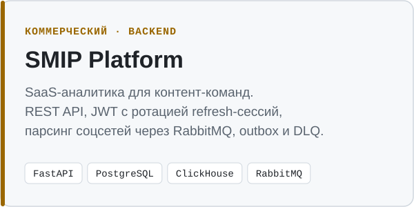

<picture>
  <source media="(prefers-color-scheme: dark)" srcset="assets/header-dark.svg" />
  
</picture>

<picture>
  <source media="(prefers-color-scheme: dark)" srcset="assets/about-dark.svg" />
  
</picture>

<a href="https://t.me/hristoforovia"><picture><source media="(prefers-color-scheme: dark)" srcset="assets/contact-telegram-dark.svg" /></picture></a>
<a href="mailto:khristoforov2008@gmail.com"><picture><source media="(prefers-color-scheme: dark)" srcset="assets/contact-email-dark.svg" /></picture></a>
<a href="https://www.bresler.ru/"><picture><source media="(prefers-color-scheme: dark)" srcset="assets/contact-site-dark.svg" /></picture></a>

### Проекты

<a href="https://smip.site">
  <picture>
    <source media="(prefers-color-scheme: dark)" srcset="assets/project-smip-platform-dark.svg" />
    
  </picture>
</a>
<a href="https://smip.site">
  <picture>
    <source media="(prefers-color-scheme: dark)" srcset="assets/project-smip-bot-dark.svg" />
    
  </picture>
</a>
<a href="https://www.bresler.ru/">
  <picture>
    <source media="(prefers-color-scheme: dark)" srcset="assets/project-bresler-dark.svg" />
    
  </picture>
</a>
<a href="https://github.com/treyzar/singularity_python_homework">
  <picture>
    <source media="(prefers-color-scheme: dark)" srcset="assets/project-bank-widget-dark.svg" />
    
  </picture>
</a>

Коммерческие проекты ведутся в закрытых репозиториях заказчиков — код могу показать по запросу.

### Стек

<picture>
  <source media="(prefers-color-scheme: dark)" srcset="assets/stack-dark.svg" />
  
</picture>
